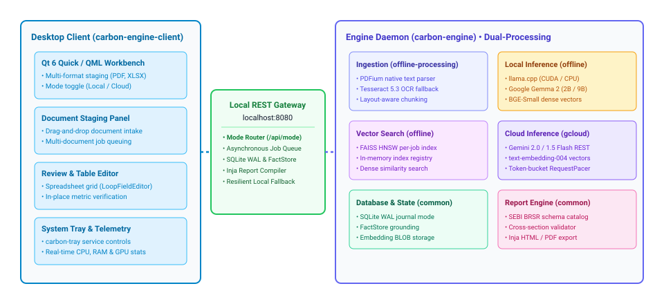

<p align="center">
  
</p>

<h1 align="center">Carbon Engine</h1>

<p align="center">
  <strong>Native C++20 Dual-Engine Platform for Statutory ESG & BRSR Compliance Analytics</strong>
</p>

<p align="center">
  <a href="https://github.com/carbonservices/carbon-engine"></a>
  <a href="https://www.qt.io/"></a>
  <a href="https://github.com/ggerganov/llama.cpp"></a>
  <a href="https://ai.google.dev/"></a>
  <a href="https://github.com/facebookresearch/faiss"></a>
  <a href="https://sqlite.org/"></a>
  <a href="LICENSE"></a>
  <a href="#contributing"></a>
</p>

<p align="center">
  
  <br/>
  <em>Carbon Engine Desktop Workspace: Real-time dual-mode extraction tracking, statutory gap cataloging, and telemetry.</em>
</p>

---

## Table of Contents

- [Overview](#overview)
- [Dual Processing Modes](#dual-processing-modes)
- [Quick Start](#quick-start)
  - [1. Start Background Daemon or Windows Service](#1-start-background-daemon-or-windows-service)
  - [2. Manage via System Tray](#2-manage-via-system-tray)
  - [3. Launch Desktop Workbench](#3-launch-desktop-workbench)
  - [4. Configure Cloud Processing Credentials](#4-configure-cloud-processing-credentials)
- [Build & Installation](#build--installation)
  - [Prerequisites](#prerequisites)
  - [Build from Source (Windows)](#build-from-source-windows)
  - [Build from Source (Linux)](#build-from-source-linux)
  - [Packaging (NSIS, ZIP, DEB, TGZ)](#packaging-nsis-zip-deb-tgz)
- [Key Features](#key-features)
- [Architecture](#architecture)
- [REST API Reference](#rest-api-reference)
- [Contributing](#contributing)
- [License](#license)

---

## Overview

Carbon Engine is a native C++20 platform and Qt 6 desktop application for corporate ESG and BRSR compliance reporting. It ingests reports, spreadsheets, invoices, and utility data, extracts required disclosures, and compiles audit-ready reports.

The engine features a **dual-processing architecture**, allowing users to toggle between 100% air-gapped local inference (zero network telemetry) and cloud-accelerated processing directly from the desktop interface without restarting background services or modifying schemas.

---

## Dual Processing Modes

Carbon Engine provides two distinct processing engines that share the same underlying schema, SQLite database, and validation rules:

| Feature | Local Mode (Air-Gapped) | Cloud Mode (Accelerated) |
|---|---|---|
| **Engine Library** | `carbon-engine-offline` | `carbon-engine-gcloud` |
| **Language Model** | Google Gemma 2 2B / 9B (GGUF via `llama.cpp`) | Gemini 2.0 Flash / 1.5 Flash (via native REST) |
| **Embeddings** | BGE-Small-EN-v1.5 (384-dimensional dense vectors) | text-embedding-004 (768-dimensional vectors) |
| **Vector Index** | In-memory FAISS HNSW (`IndexHNSWFlat`) | Cosine similarity vector index |
| **Document Parsing** | PDFium layout extraction + Tesseract 5.3 OCR fallback | Layout extraction + native structured tables |
| **Network Traffic** | Zero outbound requests (100% air-gapped) | Asynchronous HTTPS (`Qt6::Network`) |
| **Rate Governance** | Continuous local execution | Token-bucket `RequestPacer` (15 RPM generation, 100 RPM embeddings) |
| **Primary Use Case** | Confidential pre-filing binders & air-gapped facilities | High-throughput batch extraction & large filings |

- **Runtime Mode Switching**: Toggle between Local and Cloud processing instantly from the desktop client header or via `POST /api/mode`.
- **Automatic Fallback**: If cloud connectivity drops or rate limits are reached, the engine automatically notifies the user and provides instant failover to local execution.

---

## Quick Start

### 1. Start Background Daemon or Windows Service

The backend engine can be executed as a standalone console process or installed as a managed Windows Service:

#### Console Mode (Windows & Linux)
```powershell
./build/bin/carbon-engine
```
The daemon initializes local storage and listens on `http://localhost:8080`.

#### Windows Service Mode (Run as Administrator)
```powershell
# Register the Windows Service with SCM
./build/bin/carbon-engine.exe --install-service

# Start the service
./build/bin/carbon-engine.exe --start-service

# Stop and uninstall when needed
./build/bin/carbon-engine.exe --stop-service
./build/bin/carbon-engine.exe --uninstall-service
```

### 2. Manage via System Tray
Launch `carbon-tray.exe` to manage the daemon from the Windows notification area:
- Right-click the tray icon to verify status, trigger Start/Stop, or bring the main client to the foreground.

### 3. Launch Desktop Workbench
```powershell
./build/bin/carbon-engine-client
```

#### Workflow
1. **Stage Documents**: Drop annual report PDFs, Excel workbooks, or scanned receipts into the staging panel.
2. **Select Mode**: Use the header toggle to select **Local (Gemma 2)** or **Cloud (Gemini)**.
3. **Run Extraction**: Track extraction progress and telemetry in real time.
4. **Review & Edit**: Inspect extracted fields, verify source citations, and edit tabular disclosures in the review screen.
5. **Lock & Export**: Finalize disclosures and export audit-ready HTML reports or PDFs.

### 4. Configure Cloud Processing Credentials
To use cloud-accelerated extraction:
1. In the desktop client, open **Settings**.
2. Toggle **Cloud Processing** to **ON**.
3. Paste your [Google AI Studio](https://aistudio.google.com/) **API Key** and select your model (e.g., `gemini-2.0-flash`).
4. Click **Test Cloud Connection** to verify latency, then click **Save**.

---

## Build & Installation

### Prerequisites

| Component | Minimum Requirement |
|---|---|
| **Operating System** | Windows 10/11 (64-bit) or Linux (Ubuntu 22.04 LTS+) |
| **Compiler Toolchain** | MSVC 2022 (v143+) / GCC 11+ / Clang 14+ (C++20 compliant) |
| **CMake & Ninja** | CMake 3.28+ and Ninja build driver |
| **Qt 6 Framework** | Qt 6.10 or newer (Quick, Network, WebEngine) |
| **CUDA Toolkit** | *(Optional)* CUDA 12.0+ for NVIDIA GPU acceleration |

### Build from Source (Windows)
Ensure Qt 6.10+ is installed and configured in your environment:

```powershell
git clone https://github.com/carbonservices/carbon-engine.git
cd carbon-engine

# Configure with MSVC 2022 and Ninja
cmake -B build -G "Ninja" `
  -DCMAKE_BUILD_TYPE=Release `
  -DCMAKE_PREFIX_PATH="C:/Qt/6.10.0/msvc2022_64" `
  -DCARBON_ENGINE_DOWNLOAD_MODELS=ON

# Compile daemon, client, and tray executables
cmake --build build --config Release --parallel
```

Binaries are generated in `build/bin/`:
- `carbon-engine.exe` (Background daemon / service)
- `carbon-engine-client.exe` (Desktop review workbench)
- `carbon-tray.exe` (System tray controller)

### Build from Source (Linux)
Install dependencies on Ubuntu/Debian:

```bash
sudo apt-get update && sudo apt-get install -y \
  build-essential ninja-build cmake \
  libgl1-mesa-dev libxkbcommon-dev libxkbcommon-x11-dev \
  libxcb-cursor0 libxcb-xinerama0 libxcb-icccm4 libxcb-image0 \
  libxcb-keysyms1 libxcb-render-util0 libopenblas-dev \
  libtesseract-dev libleptonica-dev libpulse-dev libasound2-dev

git clone https://github.com/carbonservices/carbon-engine.git
cd carbon-engine

# Configure and compile
cmake -B build -G "Ninja" \
  -DCMAKE_BUILD_TYPE=Release \
  -DCMAKE_PREFIX_PATH="/path/to/Qt/6.10.0/gcc_64" \
  -DCARBON_ENGINE_DOWNLOAD_MODELS=ON

cmake --build build --config Release --parallel
```

### Packaging (NSIS, ZIP, DEB, TGZ)
Generate native installers using CPack:

```bash
cd build

# On Windows: Creates portable ZIP and NSIS .exe installer
cpack -C Release -G "ZIP"
cpack -C Release -G "NSIS"

# On Linux: Creates Debian .deb package and .tar.gz archive
cpack -C Release -G "DEB;TGZ"
```

---

## Key Features

- **Dual-Engine Flexibility**: Seamlessly toggle between air-gapped local execution and cloud acceleration.
- **Multi-Format Ingestion**: Ingests PDF annual reports, multi-tab Excel workbooks (`.xlsx`, `.xls`), raw CSV exports, and scanned invoices (`.png`, `.jpg`).
- **FactStore Grounding**: Caches verified baseline facts (Company Identity, Turnover, Headcount, Reporting Year) and injects them as grounding context across all downstream extraction stages.
- **Windows Service & Tray Management**: Runs as an interactive background daemon or a managed Windows Service (`carbon-engine`), with taskbar controls via `carbon-tray`.
- **Human-in-the-Loop Review**: Desktop workbench featuring tabular grid editors (`LoopFieldEditor`), data provenance auditing, and real-time telemetry.
- **Audit-Ready Reports**: Generates standalone HTML reports (via Inja templates) and high-resolution PDF exports with embedded visual charts.

---

## Architecture

The platform decouples processing, storage, and presentation across three lightweight executables communicating over a local HTTP interface (`http://localhost:8080`):

<p align="center">
  
  <br/>
  <em>Client-server communication over local REST and internal engine library architecture.</em>
</p>

Detailed technical diagrams:
- **[System Architecture](docs/architecture.drawio.svg)**: Multi-layer ingestion, chunking, FAISS vector indexing, and inference routing.
- **[Database Schema](docs/database_schema.drawio.svg)**: SQLite WAL relational tables, foreign key cascades, and embedding durability.
- **[Extraction Pipeline](docs/extraction_pipeline.drawio.svg)**: Retrieval, context budgeting, and JSON schema enforcement.

---

## REST API Reference

The backend daemon exposes a REST interface on `http://localhost:8080`:

| Endpoint | Method | Parameters / Body | Description |
|---|---|---|---|
| `/api/mode` | `GET` | None | Returns active mode (`OFFLINE` or `GCLOUD`), availability, and configured models. |
| `/api/mode` | `POST` | `{"mode": "OFFLINE" \| "GCLOUD"}` | Switches processing mode dynamically without daemon restart. |
| `/api/config/test` | `POST` | `{"api_key": "...", "model": "..."}` | Validates cloud credentials and returns service latency. |
| `/api/ingest` | `POST` | `multipart/form-data` | Ingests document binders into the processing queue. |
| `/api/jobs` | `GET` | `?job_id={id}` | Queries ingestion status, chunk counts, and page statistics. |
| `/api/extraction/start` | `POST` | `{"job_id": {id}}` | Initiates the statutory extraction pipeline. |
| `/api/extraction/status`| `GET` | `?job_id={id}` | Emits live extraction progress, active section, model, and rate pacer telemetry. |
| `/api/extraction/sections`| `GET` | `?job_id={id}` | Retrieves extracted statutory sections and validation warnings for audit. |
| `/api/extraction/sections`| `PUT` | `{"job_id": {id}, "group_id": "...", "data": {...}}` | Persists user edits to the database. |
| `/api/extraction/accept`| `POST` | `{"job_id": {id}}` | Finalizes and locks the report against further modification. |
| `/api/report/export` | `GET` | `?job_id={id}` | Compiles and serves the complete statutory report as standalone HTML. |
| `/api/system` | `GET` | None | Emits live system telemetry (CPU, RAM, GPU utilization). |

---

## Contributing

We welcome open-source contributions. Please review our [Contributing Guide](CONTRIBUTING.md) before starting.

- **Discuss First**: Open an issue to discuss design and approach before submitting a pull request.
- **Code Standards**: Follow modern C++20 conventions, RAII resource ownership, and formatting rules in `.clang-format`.
- **Policies**: Adhere to our [Code of Conduct](CODE_OF_CONDUCT.md) and [Security Policy](SECURITY.md).

---

## License

This project is licensed under the [GNU General Public License v3.0 (GPLv3)](LICENSE).

<p align="center">
  Built with precision for transparent, verifiable, and sovereign corporate sustainability reporting.
</p>
